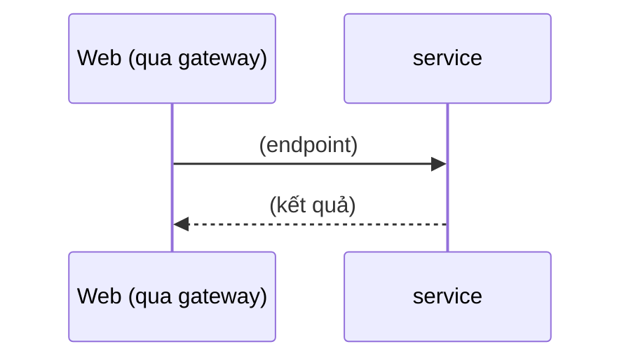

# Service `payment`

Thẻ của service: AI và người đọc tệp này trước khi sửa mã. Chủ service cập nhật nó **trong cùng
commit** với mã theo luật ở mục 4 của `CLAUDE.md` (CI `pnpm check:docs` nhắc khi quên). Mẫu này nằm
trong khuôn; `scripts/new-service.sh` điền tên.

## Thông tin

| | |
| --- | --- |
| Chủ | TV5 (điền tên, tài khoản GitHub) |
| Cổng mặc định | 3007 (`bootstrapService({ port: 3007 })`; trong compose là 3000) |
| Database | `payment` (tài khoản `payment`, `infra/postgres-init.sql`), `PG_SCHEMA=payment` |
| Gọi qua gateway | `/api/v1/payment-orders`, `/api/v1/bank-callbacks` (`gateway/routes.json` của repo cha) |
| Thẻ nhiệm vụ | `docs/nhiem-vu/TV5.md` |

## Sơ đồ mã

Mỗi tệp trong `service/src` một dòng: làm gì. AI đọc bảng này thay vì mở từng tệp.

| Tệp | Làm gì |
| --- | --- |
| `main.ts` | Khởi động: `bootstrapService({ module, name, port })` |

## Sơ đồ luồng

Luồng chính của service (Mermaid). Sửa khi đổi luồng, thêm lời gọi sang service khác hoặc sự kiện.

## Dữ liệu sở hữu

Chỉ service này ghi các bảng (collection) dưới đây; service khác hỏi qua API hoặc sự kiện.

| Collection | Ý nghĩa | Khai báo trong `packages/contracts/resources.json`? |
| --- | --- | --- |
| payments | Lệnh chi, trạng thái, khoá idempotency | chưa |
| saga-log | Bước và bù trừ của S4 | chưa |

Bản dự kiến theo `docs/PHAN_TICH_THIET_KE.md` §3; chủ service sửa khi chốt.

## Endpoint

Chi tiết ở `service/openapi.yaml`. Mỗi endpoint có ít nhất một lỗi nghiệp vụ 4xx kèm mã.

| Phương thức, đường dẫn | Quyền | Lỗi nghiệp vụ |
| --- | --- | --- |
| `POST /payment-orders (Idempotency-Key)` | phê duyệt tài chính bên mua | 409 `DECISION_NOT_PAYABLE`, `ORDER_EXISTS`; 403 |
| `POST /payment-orders/{id}/approval` | phê duyệt tài chính | 409 `ALREADY_APPROVED`; 403 |
| `GET /payment-orders, GET /payment-orders/{id}` | thành viên bên mua | 404 |
| `POST /payment-orders/{id}/retry` | phê duyệt tài chính | 409 `ALREADY_SETTLED` |
| `POST /bank-callbacks` | ngân hàng (chữ ký HMAC) | 401 |

Bản dự kiến theo `docs/PHAN_TICH_THIET_KE.md` §6 (chưa làm); `openapi.yaml` là bản chi tiết.

## Sự kiện

| Phát | Nhận |
| --- | --- |

## Nguồn CodeCash

Tệp trong `../codecash` chuyển vào service này (xem `docs/DOI_CHIEU_CODECASH.md`), và đã chuyển chưa.

| Tệp cũ | Sang | Trạng thái |
| --- | --- | --- |

## Rà soát nghiệp vụ

Chỗ mã cũ lệch, thiếu so với `../codecash/docs/NGHIEP_VU.md`, và đã xử lý thế nào.

## Cải tiến so với CodeCash

Những gì làm khác hoặc tốt hơn bản cũ, và vì sao (dùng cho báo cáo).
